  

### About

I'm an engineering student pursuing dual degrees at **Centrale Lyon** and **Xi'an Jiaotong University**, specializing in artificial intelligence, machine learning, and data analysis. I build intelligent software end to end — from research and algorithm design to machine-learning systems and polished mobile products.

### Currently

- 📱 Building **[Revelto](https://revelto.app)**, a workout tracking app for iOS & Android
- 🎓 M.Sc. Computer Science at Xi'an Jiaotong University (2025–2027)
- 🤝 Available for **freelance and contract projects** · open to internships from September 2027

### Selected Projects

**[Revelto](https://revelto.app)** · 2025–present — A workout tracking app for people who take their training seriously. Log every set, follow structured programs, and watch strength, volume, and personal records climb over time — backed by an 800+ exercise library and detailed progress analytics. [iOS](https://revelto.app/ios) · [Android](https://revelto.app/android)

**[Analysis of service returns in table tennis](https://link.springer.com/chapter/10.1007/978-3-032-15165-0_1)** · 2024–2025 — Analyzed professional match data to understand how players adapt their returns to incoming serves. Machine-learning workflows, statistical analysis, and an interactive Plotly Dash dashboard. [Code](https://github.com/centralelyon/table-tennis-returns) · [HAL](https://hal.science/hal-05201121)

**[Go game with AI](https://github.com/Riad-Attou/go-ai-app)** · 2023–2024 — A playable Go application with a complete Pygame interface, and an AI opponent built on Minimax, alpha-beta pruning, and Principal Variation Search, alongside tutorial, automatic scoring, and human-versus-computer modes.

**[Myeloid leukemia survival prediction](https://github.com/Riad-Attou/qrt_ml)** · 2025 — A machine-learning pipeline for the QRT 2024–2025 Data Challenge predicting overall survival from clinical data, exploring survival-analysis methods and gradient-boosted trees including LightGBM. Organized with Gustave Roussy.

**[Ant Colony Optimization](https://github.com/Riad-Attou/ant-colony-optimization)** · 2025 — Ant Colony Optimization for graph-based problems: pheromone updates, probabilistic path selection, and a study of how the algorithm converges toward stronger solutions across iterations.

### Experience

**AI Researcher** · Centrale Lyon & French Table Tennis Federation — 2024–2025

**Lead Developer & Project Manager** · Centrale Lyon — 2023–2024

### Publication

**[Analysis of Service Returns in Table Tennis](https://link.springer.com/chapter/10.1007/978-3-032-15165-0_1)** — Springer CCIS, vol. 2833 (MLSA 2025).

### Tech Stack

  
  
  
  
  
  
  
  
  
  
  
  

### GitHub Activity

  

### Connect

  
  
  
  

<i>Available for freelance and contract projects · open to internships from September 2027.</i>

